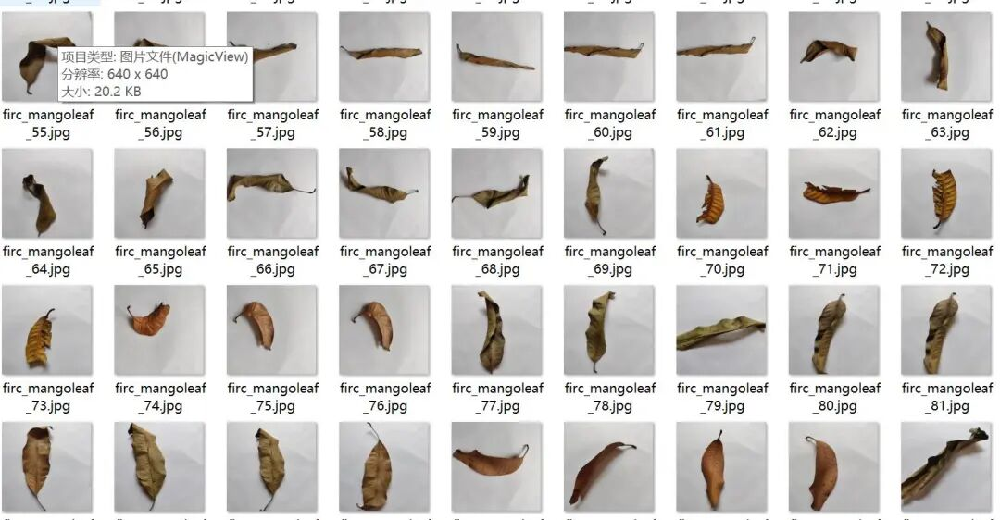
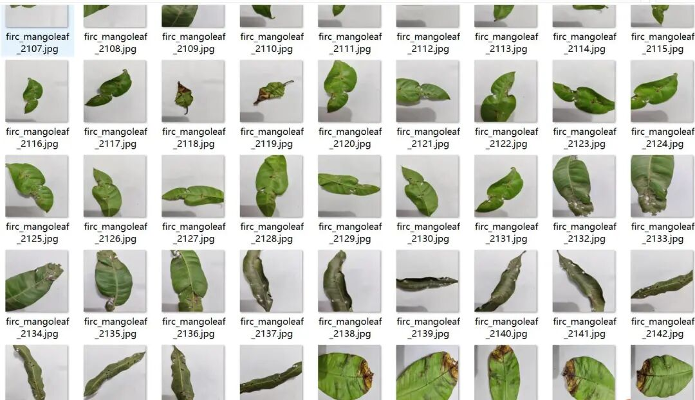
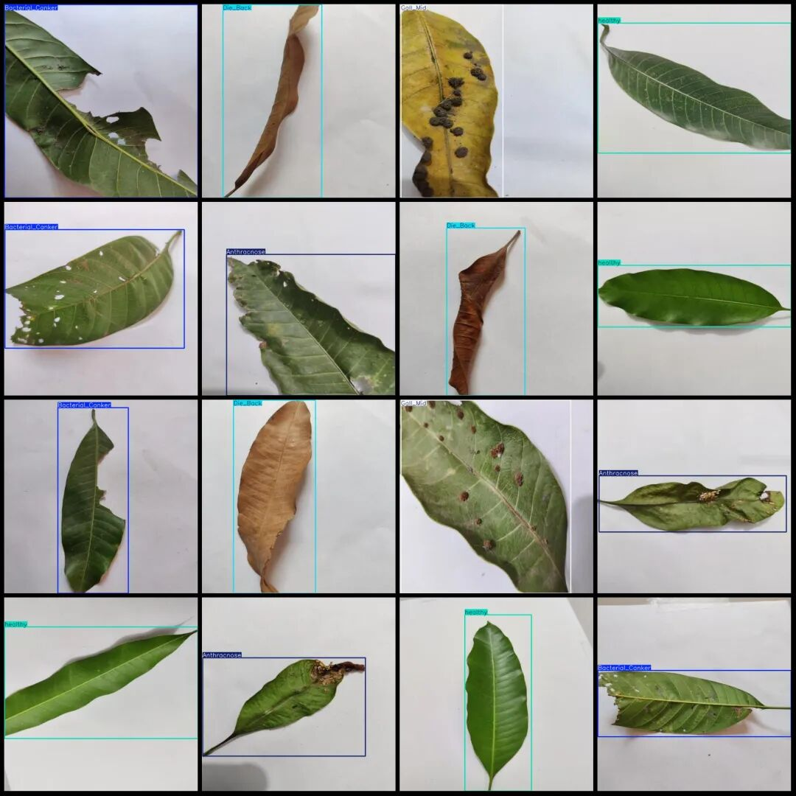
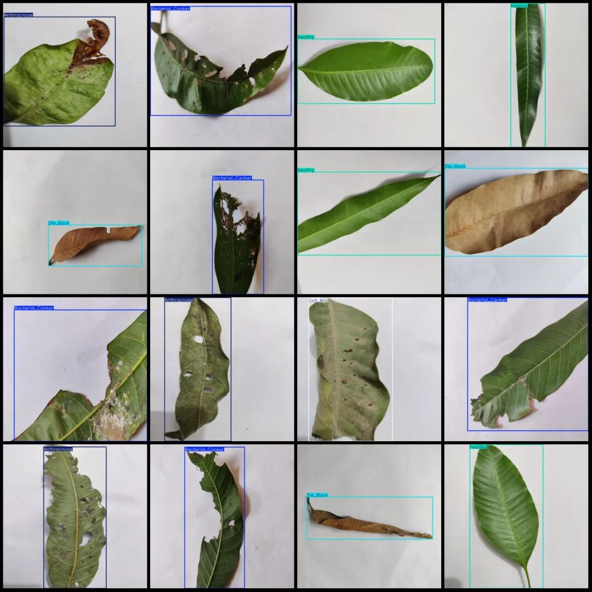

# Mango Leaf Disease Detection Dataset in VOC+YOLO format with 2925 images, 5 categories all are single leaves.

Note: There are a large number of enhanced images in the dataset.

Dataset format: Pascal VOC format + YOLO format (txt file without split path, only containing jpg images and corresponding VOC format xml files and yolo format txt files)

Number of images (number of jpg files): 2925

Number of annotations (number of xml files): 2925

Number of annotations (number of txt files): 2925

Label category count: 5

Label category names (note that the order of yolo format categories does not correspond to this, but is based on the classes.txt in the labels folder): ["Anthracnose", "Bacterial Canker", "Die Back", "Gall Mid", "healthy"]

Number of boxes labeled in each category:

Anthracnose (anthracnose) Frames = 618

Bacterial Canker (Bacterial Ulcer) Frames = 577

Die_Back (Acer bud rot)Frames = 558

Gall_Mid (Phyllopode) Frames = 600

Healthy (health) frame count = 600

Total frame count: 2953

Number of images per category:

Anthracnose (anthracnose) occupies the number of images = 592

Bacterial Canker (Bacterial Ulcerative Disease) occupies 575 images.

Die_Back (bark rot) occupies = 558

Gall_Mid (Phyllopode) occupies 600 images.

Healthy (health) occupies a picture count = 600

Image resolution: 640x640

Using labelImg:

Important Notice: The dataset does not have separate training, validation, and test sets; you need to partition them yourself.

Special : This dataset does not guarantee the accuracy of the trained models or weight files.

Image Preview:

Annotation example:

## Payment

Here is a pay link on Stripe ( https://buy.stripe.com/3cs8yP7sY87d0vu9AB ). Please contact me lonlonago@foxmail.com after funding $89, and I will send you a complete data files , thank you!

